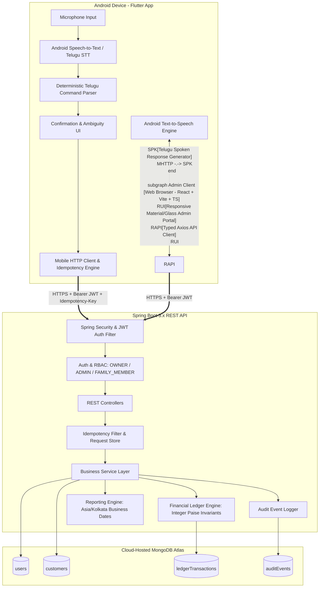
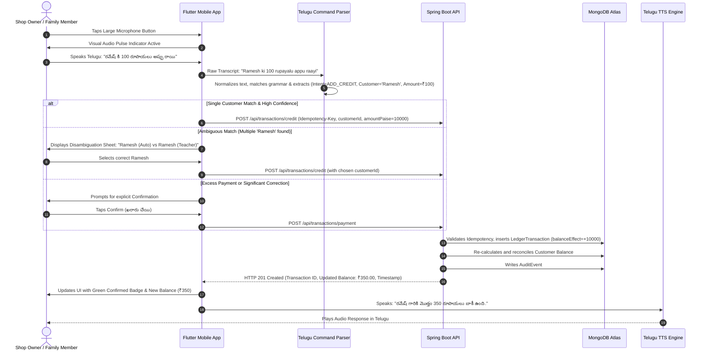

# Architecture Design: Telugu Voice-Based Tiffin Hotel Debt Management System
**(తెలుగు టిఫిన్ హోటల్ బాకీల నిర్వహణ వ్యవస్థ - Tiffin Khata)**

## 1. System Overview & Problem Statement

Small Indian tiffin hotels (టిఫిన్ సెంటర్లు / హోటళ్ళు) routinely provide credit meals, breakfast items (idli, dosa, puri, vada, upma, tea), and daily parcels to regular customers (ఉద్యోగులు, డ్రైవర్లు, వ్యాపారులు, చుట్టుపక్కల నివాసితులు).
Traditionally, the shop owner keeps a physical paper notebook (బాకీల చిట్టా / పుస్తకం).
This manual practice suffers from:
1. **Physical tear, spills (oil/chutney/water), and notebook misplacement.**
2. **Speed bottlenecks during peak morning/evening rush hours** when typing on a phone keypad is impractical.
3. **Disputes and lack of transparency** regarding past payment dates or balance calculations.
4. **Lack of family coordination** when multiple family members operate the cash counter across shifts.

This system replaces the physical notebook with an **online-first, multi-user Android mobile app with Telugu voice input** and a **centralized family-accessible React admin portal**, backed by a resilient, audited **Spring Boot REST API** and **MongoDB** database.

---

## 2. Component Architecture Diagram

---

## 3. End-to-End Voice Flow

---

## 4. Financial Ledger Domain Rules & Invariants

### 4.1 Strict Integer Paise Arithmetic
- To prevent IEEE 754 floating-point inaccuracies, **all monetary amounts in database documents, APIs, DTOs, and calculation routines are stored and computed in integer paise (1 INR = 100 paise)**.
- Example:
  - ₹100.00 $\rightarrow$ `10000` paise
  - ₹50.50 $\rightarrow$ `5050` paise
  - ₹0.00 $\rightarrow$ `0` paise

### 4.2 Transaction Types & Balance Effect Paise
Every transaction record contains both the nominal `amountPaise` (always positive) and the signed `balanceEffectPaise`:

| Transaction Type | Business Meaning | `amountPaise` | `balanceEffectPaise` |
|---|---|---|---|
| `CREDIT` | Customer consumed food on credit (Appu / బాకీ) | Positive ($>0$) | `+amountPaise` (Debt Increases) |
| `PAYMENT` | Customer paid cash or UPI | Positive ($>0$) | `-amountPaise` (Debt Decreases) |
| `DISCOUNT` | Shop owner intentionally forgives debt | Positive ($>0$) | `-amountPaise` (Debt Decreases) |
| `OPENING_BALANCE` | Migrated debt balance from physical notebook | Positive or Zero | `+amountPaise` (Initial Debt) |
| `REVERSAL` | Reverses an erroneous prior transaction | Positive ($>0$) | `-1 * original.balanceEffectPaise` |
| `ADJUSTMENT` | Signed manual adjustment with audit reason | Positive ($>0$) | $\pm\text{amountPaise}$ |

### 4.3 Reversal Invariant (Zero-Sum Double-Entry Policy)
When reversing an existing transaction:
1. The original transaction is never deleted or silently overwritten.
2. The original transaction has `hasReversal = true` and `reversalTransactionId = <new_tx_id>`.
3. A compensatory transaction of type `REVERSAL` is inserted into `ledgerTransactions` with `reversesTransactionId = <original_tx_id>` and:
   $$\text{balanceEffectPaise}_{\text{reversal}} = -1 \times \text{balanceEffectPaise}_{\text{original}}$$
4. The outstanding debt balance is computed as:
   $$\text{outstandingBalancePaise} = \sum_{\text{all posted transactions for customer}} \text{balanceEffectPaise}$$
   Because both original ($+X$) and reversal ($-X$) exist in the ledger, their sum cancel each other out ($+X - X = 0$) exactly once without double-counting!

### 4.4 Idempotency Policy
- All state-altering write requests (`/api/transactions/*`, `/api/customers/*`) accept an `Idempotency-Key` HTTP header (UUID v4 generated by Flutter or React).
- The backend checks MongoDB's `ledgerTransactions` collection where `idempotencyKey` has a unique sparse index.
- If a duplicate request arrives (e.g., duplicate microphone tap or network retry), the backend immediately returns the previously committed transaction response without re-executing business logic or incrementing debt.

---

## 5. Security & Role-Based Access Control (RBAC)

Three distinct roles are enforced on the server for every endpoint:

1. **`ROLE_OWNER`**:
   - Master account created during initial setup.
   - Unrestricted business access: View/manage users, create/edit/archive customers, record credit/payment/discount, perform transaction corrections and reversals, import opening balances, access all daily/range financial reports, export CSV data.
2. **`ROLE_ADMIN`**:
   - Authorized family member with management duties.
   - Manage customer profiles, record transactions, perform authorized corrections with audit reason. User creation privileges configurable.
3. **`ROLE_FAMILY_MEMBER`**:
   - Cash counter operational role.
   - Search customers, check balances, view transaction history, add credits, record payments.
   - **Forbidden**: Cannot apply discounts/waivers, cannot reverse or correct historical ledger entries, cannot manage users or export full system datasets.

---

## 6. Time Zone and Local Business Date Invariant
- Official business timezone: **`Asia/Kolkata` (IST, UTC+05:30)**.
- All stored timestamps (`createdAt`, `occurredAt`) use ISO-8601 UTC in MongoDB.
- Daily reports (credits today, collections today) define "Today" as `00:00:00.000` to `23:59:59.999` in `Asia/Kolkata` time, ensuring accurate reconciliation even during late night or early morning tiffin shifts (5:00 AM to 11:30 PM IST).
